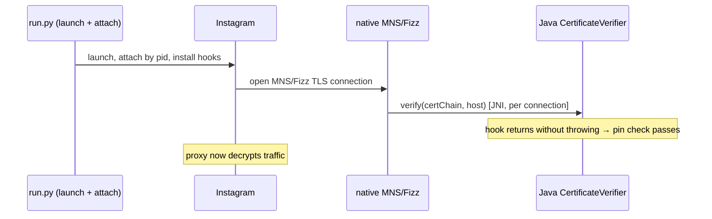

# Frida runtime guide (recommended for Instagram / Meta)

Bypass SSL pinning at **runtime** with Frida — the app APK is left completely
unmodified. This is the reliable method for hardened Meta apps
(Instagram, Facebook, Messenger, Threads) that use the **Tigon/MNS** network stack.

> Verified on Instagram **v444.0.0.0.77** (x86_64 emulator, Android 12), and on the older
> **v442.0.0.0.61 / v440.x** series. Use `instagram_v444_bypass.js` for current Instagram;
> `tigon_bypass.js` is the minimal pre-v444 script.

---

## How it works (30-second version)

Instagram's real certificate pinning is **not** OkHttp/`CertificatePinner`, and there is
**no** `libinstagram.so`. How it's enforced changed around **v444**:

**Current Instagram (v444+).** The main traffic runs through the **native MNS/Fizz TLS
stack** (`libstartup.so`); a pin mismatch fails the handshake with
`fizzy_client_connect(): Pin verification failed`. That native code doesn't check the
certificate itself — it calls back into a **Java** verifier over JNI, once per connection:
`com.facebook.mobilenetwork.internal.certificateverifier.CertificateVerifier`. Its
`verify()` / `verifyWithProofOfPossession()` are `void` and throw on a pin mismatch, so
`instagram_v444_bypass.js` **no-ops them** — verification always passes. Because the
verifier is invoked per connection (not once at startup), this works even when the script
is attached slightly late, so `run.py`'s attach-by-pid path is enough.

**Older Instagram (pre-v444).** Traffic ran through **Tigon** (Meta's cronet-based stack),
which turned cert verification on inside a Java config passed to
`com.facebook.tigon.tigonmns.TigonMNSServiceHolder.initHybrid(...)`. Hooking that call and
setting `setEnableCertificateVerificationWithProofOfPossession(false)`,
`setTrustSandboxCertificates(true)`, and `setForceHttp2(true)` disabled pinning. This is
what `tigon_bypass.js` does; `instagram_v444_bypass.js` keeps these hooks too, plus a
Conscrypt / `SSLContext` trust-all fallback for ordinary apps. Note `initHybrid` runs
**once, early at startup**, so its hook must land before it — which is why the older setup
leaned on spawn timing; the v444 MNS hook does not.



For the full architecture and the analysis behind this, see [INSTAGRAM-ANALYSIS.md](INSTAGRAM-ANALYSIS.md).

---

## Requirements

| Component | Notes |
|---|---|
| **Rooted** device / emulator | `adb root` works, or `su` is available. Required to run frida-server. |
| **frida-server** | Binary matching the device ABI (x86_64 emulator → `...-android-x86_64`). |
| **frida client** | **Same version** as frida-server. Frida 17.x needs **Python 3.11+**. |
| Proxy | Burp Suite / mitmproxy with its CA installed as a **user** cert on the device. |

> Emulator note: Android Studio's **"Play Store"** AVD images are **not rootable**
> (`adb root` fails). Use a **"Google APIs"** image (no Play Store, rootable) or a
> rooted third-party emulator (MEmu / LDPlayer / Nox — these usually have both root
> and Play Store).

---

## Windows environment setup

### 1. adb (platform-tools)

Download a minimal Windows adb from <https://github.com/awake558/adb-win> (*Code ▸
Download ZIP*), extract to e.g. `C:\adb`, and add that folder to **PATH**:

- Start menu → *"environment variables"* → **Edit the system environment variables** →
  **Environment Variables…** → under **User variables** edit **Path** → **New** →
  `C:\adb` → OK. **Open a new terminal.**
- CLI alternative: `setx PATH "$($env:Path);C:\adb"` (affects new terminals only).

```powershell
adb version        # verify
adb devices        # your device/emulator should appear
```

> Official package also works: <https://developer.android.com/tools/releases/platform-tools>

### 2. Python 3.11+ (Frida 17 dropped 3.10)

Install from <https://www.python.org/downloads/> with **"Add python.exe to PATH"** ticked.
`py -0p` lists versions. This guide uses `py -3.13`.

### 3. Frida client

```powershell
py -3.13 -m pip install "frida==17.16.4" "frida-tools"
frida --version        # 17.16.4
```

### 4. frida-server (on the rooted device)

Download the build matching your device ABI from
<https://github.com/frida/frida/releases>
(e.g. `frida-server-17.16.4-android-x86_64.xz`), unpack the `.xz`, then:

```powershell
adb push frida-server-17.16.4-android-x86_64 /data/local/tmp/frida-server
adb shell chmod 755 /data/local/tmp/frida-server
adb shell "/data/local/tmp/frida-server &"
frida-ps -U            # lists device processes if everything works
```

> **Client and server versions must match exactly**, and the server ABI must match the
> device (x86_64 emulator → `-x86_64`; most phones → `-arm64`).

### 5. Proxy + CA

Install **Burp Suite** / **mitmproxy**, install its CA on the device as a **user**
certificate (*Settings ▸ Security ▸ Encryption & credentials ▸ Install a certificate ▸
CA certificate*), and set the device Wi-Fi proxy to your PC's `IP:8080`.

---

## Usage

> Run these from the repository root (`patchapk/`) so `frida\instagram_v444_bypass.js` resolves.

### Recommended: the bundled runner (`run.py`)

`frida\run.py` launches the app, injects the script, and keeps the session alive. It tries
`spawn` first and, if that times out (common with Instagram on emulators — see below), it
**falls back to launching via `adb` and attaching to the app's main pid**. For v444+ that's
fine: the MNS verifier is called per connection, so a slightly-late attach still catches it.

```powershell
# Start frida-server on the device (if not already running) — from PowerShell, not Git Bash
adb shell "/data/local/tmp/frida-server &"

# Launch Instagram with the v444+ bypass
py -3.13 frida\run.py                                        # Instagram + instagram_v444_bypass.js
py -3.13 frida\run.py com.instagram.android frida\instagram_v444_bypass.js
#   Look for: [+] MNS CertificateVerifier.verify* neutralized (v444+ pinning off)
```

If your setup's spawn is known-broken, skip the ~15 s spawn timeout and go straight to the
attach fallback. `adb` must be on PATH, or point `ADB` at it:

```powershell
$env:ADB="D:\platform-tools\adb.exe"; $env:FRIDA_ATTACH="1"
py -3.13 frida\run.py
```

Then set the device Wi-Fi proxy to your host `IP:8080` (Burp) and use the app.
`i.instagram.com` / `graph.instagram.com` requests appear decrypted in the proxy.
`run.py` also loads several scripts at once (the equivalent of the CLI's repeated `-l`):

```powershell
py -3.13 frida\run.py com.instagram.android frida\instagram_v444_bypass.js my-probe.js
```

### Alternative: the `frida` CLI

If your emulator's `spawn` works, the plain CLI is fine (use `tigon_bypass.js` instead for
pre-v444 Instagram):

```powershell
frida -U -f com.instagram.android -l frida\instagram_v444_bypass.js
```

> If the `frida` command is not on PATH, use `py -3.13 -m frida_tools.repl` instead of `frida`.
> On some emulators `frida -f` fails with *"Failed to spawn: unexpectedly timed out while
> waiting for app to launch"* — that's why `run.py` (above) is the recommended path.

---

## Testing / verifying the bypass

1. Launch with the command above; confirm the
   `[+] MNS CertificateVerifier.verify* neutralized` line (and, on older builds,
   `[+] Tigon initHybrid hooked`).
2. The app should reach its normal login / feed screen instead of a
   *"문제가 발생했습니다" / "Something went wrong"* config-load error.
3. In the app, type any username + wrong password and press **Log in**.
   **Success signal:** **"Incorrect password"** (a real server response — the request
   reached the server, so pinning is bypassed). **Failure signal:** a network error, or the
   log still shows `fizzy_client_connect(): Pin verification failed` (pinning still blocking).
4. Confirm the request is visible in Burp's HTTP history.

---

## Troubleshooting

| Symptom | Cause & fix |
|---|---|
| **App opens then closes by itself** (even with no Frida attached) | Not the bypass and not anti-Frida. Usually the **emulator's media stack** crashing the app at startup — tombstone shows `SIGILL` in `libmedia.so` / `MediaCodec` on a worker thread. **Reboot the emulator** (`adb reboot`, or cold-boot it) — that clears the degraded state. Confirm by launching the app *without* Frida: if it still dies, it's the emulator, not your setup. |
| `frida -f` → *"timed out while waiting for app to launch"* | The CLI/`spawn` flow hangs even though the app launches (not anti-Frida). **Use `py -3.13 frida\run.py`** — it auto-falls back to launch + attach-by-pid. If even that's flaky, force the fallback: `$env:FRIDA_ATTACH="1"`. |
| Attach fails with *"unable to find process with name …"* while the app is clearly running | frida-server can enumerate but the app is missing from the list under that exact name. Attaching **by pid** still works — `run.py`'s fallback does exactly this (`adb pidof` → attach by number). |
| App crashes on inject (tombstone shows `frida-agent` / stack overflow) | A script that hooks the same method repeatedly recurses. `tigon_bypass.js` hooks once; keep that guard in custom scripts. |
| Login shows *"An unexpected error occurred"* | Hook installed too late — use **`-f` (spawn)**, not `-U` (attach). |
| `ReferenceError: 'Java' is not defined` | Frida 17 raw scripts have no Java bridge. Run via the **`frida` CLI** (frida-tools loads it). |
| frida client import error (`NotRequired`) | Frida 17.x needs **Python 3.11+**; 3.10 fails. |
| Nothing in the proxy | Check Wi-Fi proxy + that the CA is a **user** cert. `setForceHttp2(true)` already forces HTTP/2 over QUIC. |
| `frida-ps -U` shows nothing | frida-server not running, or client/server version mismatch, or wrong ABI. |

---

## Notes

- Works on other Meta apps (Facebook / Threads / Messenger) that share Tigon —
  same script.
- The unmodified, store-installed app is ideal here: no repackaging means the app's
  tamper/signature checks never fire.
- Credit for the Tigon technique: frida codeshare `@takaotr` (and same-family scripts).
